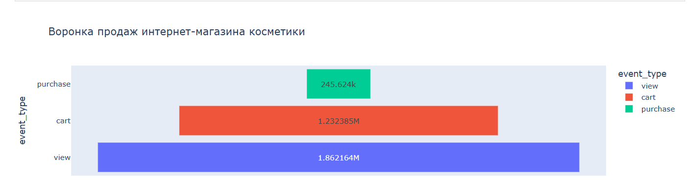
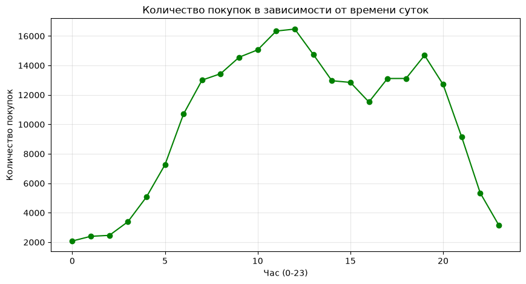

Анализ поведения пользователей в E-commerce (Косметика)

Описание проекта
Учебный проект по продуктовой аналитике на основе логов интернет-магазина косметики за октябрь 2019 года (более 4 миллионов записей). 

Цель
Проанализировать поведение пользователей, построить воронку продаж, выявить узкие места конверсии и определить самых популярных брендов.

Стек
- Python (Pandas) — очистка данных, группировка, подготовка метрик
- Python (Matplotlib, Plotly) — интерактивная визуализация
- SQL (SQLite) — написание аналитических запросов (топ брендов, топ товаров)
- GitHub — оформление портфолио

Ключевые инсайты
1. Воронка продаж: Из 1.86 млн просмотров товары в корзину добавляют 1.23 млн раз, но покупку совершают только 245 тысяч раз. Конверсия из корзины в покупку составляет всего ~20%. Это главное узкое место — клиенты боятся или не хотят завершать оплату.
2. Топ брендов: Лидерами по выручке являются *runail* и *irisk*. Также большое количество покупок приходится на товары без указанного бренда (Unknown).
3. Время покупок: Пики активности покупателей приходятся на 11:00–12:00 и 19:00. Ночью (с 0 до 5 утра) активность минимальна. Это время лучше всего подходит для запуска рекламных кампаний.
4. Конверсия брендов: У брендов *ecocraft* и *sanoto* самая высокая конверсия в покупку (50%), что говорит об их высокой привлекательности для клиентов.

Визуализация
Воронка продаж

Активность покупок по часам

Файлы проекта
- `ecommerce_analysis.ipynb` — Jupyter Notebook с полным кодом (Pandas + SQL)
- `*.png` — графики
- `clean_ecommerce_final.csv` — очищенные данные (опционально, можно не загружать из-за размера)
